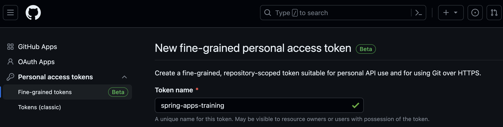
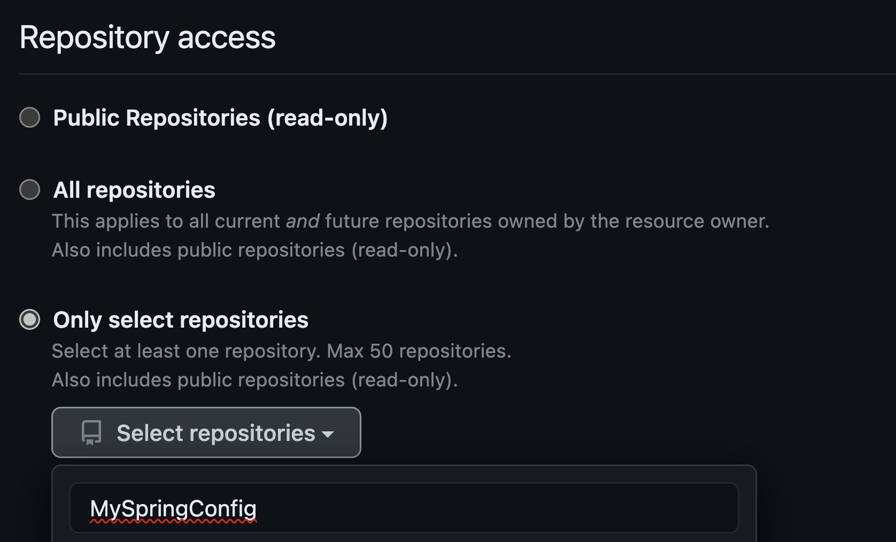
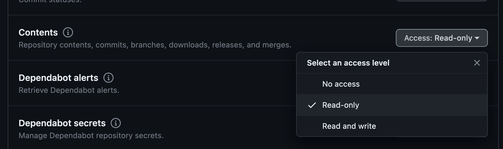
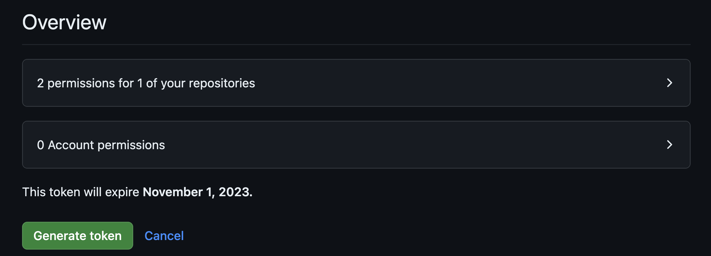

# 04 - Configure a Spring Cloud Config server

__This guide is part of the [Azure Container Apps training](../README.md)__

A key feature of cloud-native applications is *externalized configuration* - the ability to store, manage, and version configuration separately from the application code. In this section, we'll deploy a [Spring Cloud Config Server](https://cloud.spring.io/spring-cloud-config) as a container app to enable this functionality. In the next section, you'll see how Spring Cloud Config can inject configuration from a Git repository into your application.

---

> 💡 If your organization uses Azure Repos as your source code repository, see [Using Azure Repos for configuration](AzureReposForConfig.md)

> ⏱ If you want to skip the step of creating a private repository, you can use this public repository instead: [https://github.com/Azure-Samples/spring-cloud-sample-public-config.git](https://github.com/Azure-Samples/spring-cloud-sample-public-config.git). __Storing configuration in a public repository is not recommended in real-world deployments.__ We offer this public repository only as a shortcut for this workshop, for example if you don't have a GitHub account.

## Create a Git repository for storing the application configuration

On your [GitHub account](https://github.com), create a new **private** repository where the Spring Boot configurations will be stored.

In the new private GitHub repository, add a new `application.yml` file which will store configuration data for all our microservices.

Typically, each Spring Boot application includes such a file within the application's deployable artifact to contain application settings. A Spring Cloud Config Server allows such settings to be stored at a single location and served from a single source.

For the moment, our `application.yml` will just store a message to check if the configuration is successful:

```yaml
application:
    message: Configured by Azure Container Apps
```

Commit and push the new file.

## Create a GitHub personal token

Spring Cloud Config Server can access Git repositories that are public, secured by SSH, or secured using HTTP basic authentication. We will use that last option, as it is easier to create and manage with GitHub.

Let's create a new token by going into the GitHub developer settings and selecting "Personal access tokens" and "Fine-grained tokens" in the menu. Give it a name such as `container apps training`.



We select the private config repository, we've just created.



And then we specify the Repository permissions.


Only the `Contents` `Read-only` permission is required.



After that is done, click on "Generate token" and copy the token value.



Once the token is generated, leave that tab open until the end of this section.

If you need more help here, please follow the [GitHub guide to create a personal token documentation.](https://help.github.com/en/articles/creating-a-personal-access-token-for-the-command-line)

## Deploy Spring Cloud Config Server to Azure Container Apps

Now we'll deploy Spring Cloud Config Server as a container app. We'll use the official Spring Cloud Config Server Docker image and configure it with environment variables.

First, set environment variables for your Git repository:

>🛑 Replace `YOUR_GITHUB_USERNAME` with your GitHub username and `YOUR_GITHUB_TOKEN` with the token you created above. Replace `YOUR_REPO_NAME` with your config repository name (e.g., `spring-cloud-config-repo`).

```bash
export GIT_REPO_URI=https://github.com/YOUR_GITHUB_USERNAME/YOUR_REPO_NAME.git
export GIT_USERNAME=YOUR_GITHUB_USERNAME
export GIT_PASSWORD=YOUR_GITHUB_TOKEN
```

Or, if using the public sample repository:

```bash
export GIT_REPO_URI=https://github.com/Azure-Samples/spring-cloud-sample-public-config.git
```

Now deploy the Spring Cloud Config Server:

```bash
az containerapp create \
    --name config-server \
    --resource-group $AZ_RESOURCE_GROUP \
    --environment $AZ_CONTAINERAPP_ENV \
    --image hyness/spring-cloud-config-server:latest \
    --target-port 8888 \
    --ingress internal \
    --env-vars \
        SPRING_CLOUD_CONFIG_SERVER_GIT_URI=$GIT_REPO_URI \
        SPRING_CLOUD_CONFIG_SERVER_GIT_DEFAULT_LABEL=main \
        SPRING_CLOUD_CONFIG_SERVER_GIT_USERNAME=$GIT_USERNAME \
        SPRING_CLOUD_CONFIG_SERVER_GIT_PASSWORD=$GIT_PASSWORD \
    --min-replicas 1 \
    --max-replicas 1
```

> 💡 Note: We're using `--ingress internal` so the config server is only accessible from within the Container Apps environment, not from the public internet. This is a security best practice.

If using the public repository (without authentication):

```bash
az containerapp create \
    --name config-server \
    --resource-group $AZ_RESOURCE_GROUP \
    --environment $AZ_CONTAINERAPP_ENV \
    --image hyness/spring-cloud-config-server:latest \
    --target-port 8888 \
    --ingress internal \
    --env-vars \
        SPRING_CLOUD_CONFIG_SERVER_GIT_URI=https://github.com/Azure-Samples/spring-cloud-sample-public-config.git \
        SPRING_CLOUD_CONFIG_SERVER_GIT_DEFAULT_LABEL=main \
    --min-replicas 1 \
    --max-replicas 1
```

Get the internal URL of the config server:

```bash
CONFIG_SERVER_URL=$(az containerapp show \
    --name config-server \
    --resource-group $AZ_RESOURCE_GROUP \
    --query properties.configuration.ingress.fqdn \
    -o tsv)

echo "Config Server URL: http://$CONFIG_SERVER_URL"
```

## Review

We have now created a private configuration repository and deployed a Spring Cloud Config Server as a container app with the configuration files from this repository.

In the next section, we will create an application that consumes this configuration, specifically the custom message we defined in `application.yml`.

---

⬅️ Previous guide: [03 - Configure application logs](../03-configure-monitoring/README.md)

➡️ Next guide: [05 - Build a Spring Boot microservice using Spring Cloud features](../05-build-a-spring-boot-microservice-using-spring-cloud-features/README.md)
