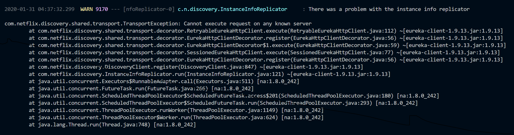
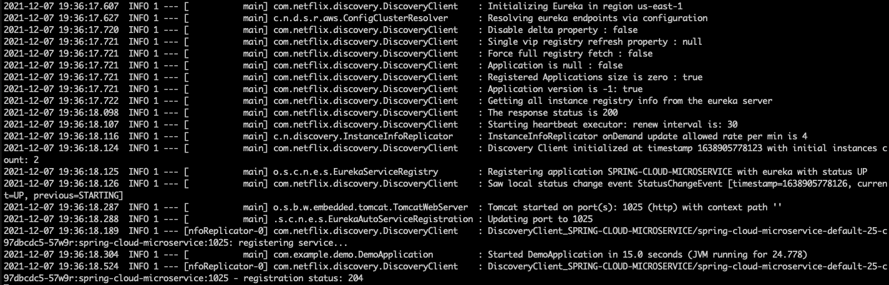
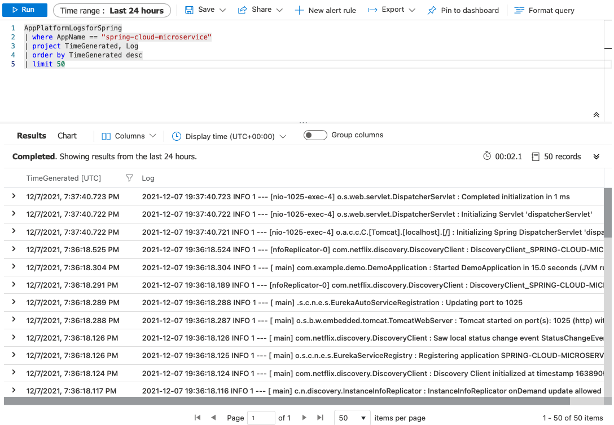

# 05 - Build a Spring Boot microservice using Spring Cloud features

__This guide is part of the [Azure Container Apps training](../README.md)__

In this section, we'll build a similar service to the one from section 2, but with the addition of Spring Cloud Config client capabilities. We'll use Spring Cloud Config to inject a setting from a Git repository (via our config server) into the application and display it on the screen.

---

## What we are going to build

This guide builds upon the previous guides: we are going to build again a simple Spring Boot microservice like in [02 - Build a simple Spring Boot microservice](../02-build-a-simple-spring-boot-microservice/README.md), but this time it will use Spring Cloud Config:

- It will get its configuration from the Spring Cloud Config server that we configured in the previous guide, [04 - Configure a Spring Cloud Config server](../04-configure-a-spring-cloud-config-server/README.md)

It will just be a matter of adding an official Spring Boot starter, and configuring the connection to our config server.

## Create a simple Spring Cloud microservice

The microservice that we create in this guide is [available here](spring-cloud-microservice/).

To create our microservice, we will invoke the Spring Initalizer service from the command line:

```bash
curl https://start.spring.io/starter.tgz -d type=maven-project -d dependencies=web,cloud-config-client -d baseDir=spring-cloud-microservice -d bootVersion=3.1.3 -d javaVersion=17 | tar -xzvf -
```

> This time, we add the `Config Client` Spring Boot starter, which will automatically trigger the use of the Spring Cloud Config Server.

## Add a new Spring MVC Controller

Next to the DemoApplication class, create a new class called `HelloController` with the following content:

```java
package com.example.demo;

import org.springframework.beans.factory.annotation.Value;
import org.springframework.web.bind.annotation.GetMapping;
import org.springframework.web.bind.annotation.RestController;

@RestController
public class HelloController {

    @Value("${application.message:Not configured by Spring Cloud Config Server}")
    private String message;

    @GetMapping("/hello")
    public String hello() {
        return message + '\n';
    }
}
```

## Configure Spring Boot

Edit the file `src/main/resources/application.properties` and add the following lines:

```properties
spring.config.import=optional:configserver:http://${CONFIG_SERVER_URL:localhost:8888}
spring.application.name=spring-cloud-microservice
```

The first line makes the Spring Cloud Config server optional for local development. The second line sets the application name, which will be used by the config server to identify which configuration to serve.

> 💡 The `CONFIG_SERVER_URL` will be provided as an environment variable when we deploy to Azure Container Apps.

## Test the project locally

Before deploying the microservice to Azure Container Apps, let's run it locally.

>💡 Do not be alarmed when you see exception stack traces:
> 
>Spring Cloud is attempting to contact a local configuration server, which we have not provided. The application will still start using any available local settings and defaults.

To run `simple-cloud-microservice` locally:

```bash
cd spring-cloud-microservice
./mvnw spring-boot:run &
cd ..
```

Requesting the `/hello` endpoint should return the "Not configured by Spring Cloud Server" message.

```bash
curl http://127.0.0.1:8080/hello
```

Kill the locally running microservice:

```bash
kill %1
```

## Create and deploy the application on Azure Container Apps

First, create a `Dockerfile` in the `spring-cloud-microservice` directory:

```bash
cd spring-cloud-microservice
cat > Dockerfile << 'EOF'
FROM eclipse-temurin:17-jdk-alpine as build
WORKDIR /workspace/app

COPY mvnw .
COPY .mvn .mvn
COPY pom.xml .
COPY src src

RUN ./mvnw package -DskipTests
RUN mkdir -p target/dependency && (cd target/dependency; jar -xf ../*.jar)

FROM eclipse-temurin:17-jre-alpine
VOLUME /tmp
ARG DEPENDENCY=/workspace/app/target/dependency
COPY --from=build ${DEPENDENCY}/BOOT-INF/lib /app/lib
COPY --from=build ${DEPENDENCY}/META-INF /app/META-INF
COPY --from=build ${DEPENDENCY}/BOOT-INF/classes /app
ENTRYPOINT ["java","-cp","app:app/lib/*","com.example.demo.DemoApplication"]
EOF
cd ..
```

Now get the config server URL and deploy the application:

```bash
# Get the config server internal URL
CONFIG_SERVER_URL=$(az containerapp show \
    --name config-server \
    --resource-group $AZ_RESOURCE_GROUP \
    --query properties.configuration.ingress.fqdn \
    -o tsv)

cd spring-cloud-microservice
./mvnw clean package -DskipTests

# Deploy to Azure Container Apps
az containerapp up \
    --name spring-cloud-microservice \
    --resource-group $AZ_RESOURCE_GROUP \
    --environment $AZ_CONTAINERAPP_ENV \
    --source . \
    --target-port 8080 \
    --ingress external \
    --env-vars CONFIG_SERVER_URL=$CONFIG_SERVER_URL

cd ..
```

## Test the project in the cloud

Get the URL for your microservice:

```bash
MICROSERVICE_URL=$(az containerapp show \
    --name spring-cloud-microservice \
    --resource-group $AZ_RESOURCE_GROUP \
    --query properties.configuration.ingress.fqdn \
    -o tsv)

curl https://$MICROSERVICE_URL/hello
```

You can now use cURL to test the `/hello` endpoint, this time it is served by Azure Container Apps and configured using the Spring Config Server from [04 - Configure a Spring Cloud Config server](../04-configure-a-spring-cloud-config-server/README.md).

As a result, requesting the `/hello` endpoint should return the message that we configured in the `application.yml` file, coming from the Spring Cloud Config Server:

```bash
Configured by Azure Container Apps
```

## Stream application logs

When you run an application on your machine, you can see its output in the console. When you run a microservice on Azure Container Apps, you can also see its console output through Azure CLI:

```bash
az containerapp logs show \
    --name spring-cloud-microservice \
    --resource-group $AZ_RESOURCE_GROUP \
    --follow
```

_Please be aware it might take a couple of minutes for the logs to show up._

You should see the console output of `spring-cloud-microservice` scroll by on your terminal:



Press CTRL+C to stop following the output and return to the shell.

## Query application logs

Streaming the console output as we just did may be helpful in understanding the immediate state of a microservice. However, sometimes it's necessary to look further into the past or to look for something specific. This is easily done with Log Analytics. In section 3, we configured log aggregation in Azure Log Analytics.

[Open Azure Portal](https://portal.azure.com/?WT.mc_id=java-spring-judubois) and navigate to your Container Apps environment. Click on "Logs". This is a shortcut to the Log Analytics workspace that was created earlier. If a tutorial appears, feel free to skip it for now.

This workspace allows you to run queries on the aggregated logs. The most common query is to get the latest log from a specific application:

Here is how to get the 50 most recent logs for the microservice we just deployed:

Insert this text in the text area that states "Type your queries here or click on of the example queries to start". Click the text of the query, then click "Run".

```kusto
ContainerAppConsoleLogs_CL
| where ContainerAppName_s == "spring-cloud-microservice"
| project TimeGenerated, Log
| order by TimeGenerated desc
| limit 50
```



>💡 It can also take 1-2 minutes for the console output of an Azure Container Apps microservice to be read into Log Analytics.

## Conclusion

Congratulations, you have deployed a complete Spring Cloud microservice, using Spring Cloud Service Registry and Spring Cloud Config Server!

If you need to check your code, the final project is available in the ["spring-cloud-microservice" folder](spring-cloud-microservice/).

---

⬅️ Previous guide: [04 - Configure a Spring Cloud Config server](../04-configure-a-spring-cloud-config-server/README.md)

➡️ Next guide: [06 - Build a reactive Spring Boot microservice using Cosmos DB](../06-build-a-reactive-spring-boot-microservice-using-cosmosdb/README.md)
