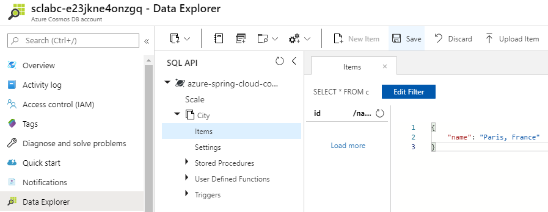

# 06 - Build a reactive Spring Boot microservice using Cosmos DB

__This guide is part of the [Azure Container Apps training](../README.md)__

In this section, we'll build an application that uses a [Cosmos DB database](https://docs.microsoft.com/en-us/azure/cosmos-db/?WT.mc_id=azurespringcloud-github-judubois) in order to access a globally-distributed database with optimum performance.

We'll use the reactive programming paradigm to build our microservice in this section, leveraging the [Spring reactive stack](https://docs.spring.io/spring/docs/current/spring-framework-reference/web-reactive.html). In contrast, we'll build a more traditional data-driven microservice in the next section.

---

## Prepare the Azure Cosmos DB database

From Section 00, you should already have a Cosmos DB account named `sclabc-<unique string>`.

- Click on the `Data Explorer` menu item
  - Expand the container named `azure-container-apps-cosmosdb`.
  - In that container, expand the container named `City`.
  - Click on `Items` and use the `New Item` button to create some sample items using the contents below:

    ```json
    {
        "name": "Paris, France"
    }
    ```

    ```json
    {
        "name": "London, UK"
    }
    ```



## Create a Spring WebFlux microservice

The microservice that we create in this guide is [available here](city-service/).

To create our microservice, we will invoke the Spring Initalizr service from the command line:

```bash
curl https://start.spring.io/starter.tgz -d type=maven-project -d dependencies=webflux,cloud-eureka,cloud-config-client -d baseDir=city-service -d bootVersion=3.1.3 -d javaVersion=17 | tar -xzvf -
```

> We use the `Spring WebFlux`, `Eureka Discovery Client` and the `Config Client` Spring Boot starters. Note: For Azure Container Apps, we won't be using service discovery, but we keep these dependencies for consistency with the original code.

## Add the Azure Cosmos DB API

In the application's `pom.xml` file, add the Azure Cosmos DB dependency just after the `spring-cloud-starter-netflix-eureka-client` dependency:

```xml
        <dependency>
            <groupId>com.azure</groupId>
            <artifactId>azure-cosmos</artifactId>
            <version>4.47.0</version>
        </dependency>
```

## Add Spring reactive code to get the data from the database

Next to the `DemoApplication` class, create a `City` domain object:

```java
package com.example.demo;

class City {

    private String name;

    public String getName() {
        return name;
    }

    public void setName(String name) {
        this.name = name;
    }
}
```

Then, in the same location, create a new `CityController.java` file that
contains the code that will be used to query the database.

> The CityController class will get its Cosmos DB configuration from environment variables that we will configure later.

```java
package com.example.demo;

import com.azure.cosmos.CosmosAsyncContainer;
import com.azure.cosmos.CosmosClientBuilder;
import com.azure.cosmos.models.CosmosQueryRequestOptions;
import com.azure.cosmos.models.FeedResponse;

import org.springframework.beans.factory.annotation.Value;
import org.springframework.web.bind.annotation.GetMapping;
import org.springframework.web.bind.annotation.RestController;
import reactor.core.publisher.Flux;

import jakarta.annotation.PostConstruct;
import java.util.List;

@RestController
public class CityController {

    @Value("${azure.cosmos.uri}")
    private String cosmosDbUrl;

    @Value("${azure.cosmos.key}")
    private String cosmosDbKey;

    @Value("${azure.cosmos.database}")
    private String cosmosDbDatabase;

    private CosmosAsyncContainer container;

    @PostConstruct
    public void init() {
        container = new CosmosClientBuilder()
                .endpoint(cosmosDbUrl)
                .key(cosmosDbKey)
                .buildAsyncClient()
                .getDatabase(cosmosDbDatabase)
                .getContainer("City");
    }

    @GetMapping("/cities")
    public Flux<List<City>> getCities() {
        CosmosQueryRequestOptions options = new CosmosQueryRequestOptions();
        return container.queryItems("SELECT TOP 20 * FROM City c", options, City.class)
                .byPage()
                .map(FeedResponse::getResults);
    }
}
```

## Create a Dockerfile

Create a `Dockerfile` in the `city-service` directory, similar to the one in section 02:

```bash
cd city-service
cat > Dockerfile << 'EOF'
FROM eclipse-temurin:17-jdk-alpine as build
WORKDIR /workspace/app

COPY mvnw .
COPY .mvn .mvn
COPY pom.xml .
COPY src src

RUN ./mvnw package -DskipTests
RUN mkdir -p target/dependency && (cd target/dependency; jar -xf ../*.jar)

FROM eclipse-temurin:17-jre-alpine
VOLUME /tmp
ARG DEPENDENCY=/workspace/app/target/dependency
COPY --from=build ${DEPENDENCY}/BOOT-INF/lib /app/lib
COPY --from=build ${DEPENDENCY}/META-INF /app/META-INF
COPY --from=build ${DEPENDENCY}/BOOT-INF/classes /app
ENTRYPOINT ["java","-cp","app:app/lib/*","com.example.demo.DemoApplication"]
EOF
cd ..
```

## Get Cosmos DB connection details

Get the Cosmos DB connection information that we'll use as environment variables. These commands assume you're using the Cosmos DB account created in section 00:

```bash
# Get the Cosmos DB account name (adjust if you have multiple accounts)
export COSMOS_DB_NAME=$(az cosmosdb list --resource-group $AZ_RESOURCE_GROUP --query '[0].name' -o tsv)
export COSMOS_DB_URI=$(az cosmosdb show --name $COSMOS_DB_NAME --resource-group $AZ_RESOURCE_GROUP --query documentEndpoint -o tsv)
export COSMOS_DB_KEY=$(az cosmosdb keys list --name $COSMOS_DB_NAME --resource-group $AZ_RESOURCE_GROUP --query primaryMasterKey -o tsv)
```

## Deploy the application

You can now build your "city-service" project and deploy it to Azure Container Apps:

```bash
cd city-service
./mvnw clean package -DskipTests

az containerapp create \
    --name city-service \
    --resource-group $AZ_RESOURCE_GROUP \
    --environment $AZ_CONTAINERAPP_ENV \
    --source . \
    --target-port 8080 \
    --ingress internal \
    --env-vars \
        AZURE_COSMOS_URI=$COSMOS_DB_URI \
        AZURE_COSMOS_KEY=$COSMOS_DB_KEY \
        AZURE_COSMOS_DATABASE=azure-container-apps-cosmosdb

cd ..
```

## Test the project in the cloud

Since the city-service has internal ingress, you can test it using the Azure Container Apps exec command:

```bash
az containerapp exec \
    --name city-service \
    --resource-group $AZ_RESOURCE_GROUP \
    --command "wget -qO- http://localhost:8080/cities"
```

You should get the list of cities you created. For example, if you only created `Paris, France` and `London, UK` as is shown in this guide, you should get:

```json
[[{"name":"Paris, France"},{"name":"London, UK"}]]
```

If you need to check your code, the final project is available in the ["city-service" folder](city-service/).

---

⬅️ Previous guide: [05 - Build a Spring Boot microservice using Spring Cloud features](../05-build-a-spring-boot-microservice-using-spring-cloud-features/README.md)

➡️ Next guide: [07 - Build a Spring Boot microservice using MySQL](../07-build-a-spring-boot-microservice-using-mysql/README.md)
