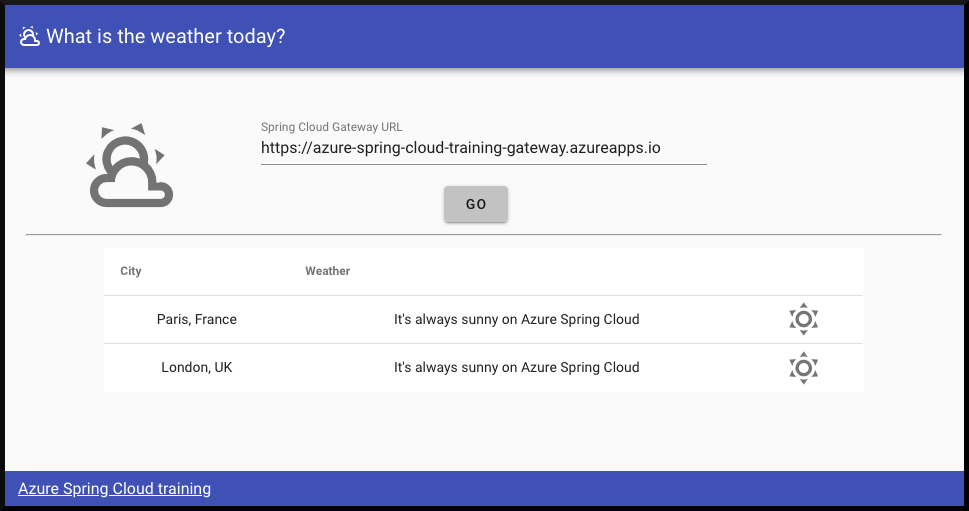

# 10 - Blue/Green deployment

__This guide is part of the [Azure Container Apps training](../README.md)__

The blue-green deployment pattern allows you to test latest application changes on production infrastructure, but without exposing the changes to consumers until your testing is complete. In this section, we'll perform a blue-green deployment using Azure Container Apps revisions. Although we will go through the deployment steps manually, the Azure CLI commands we'll use can be automated in a CI/CD pipeline.

---

We are going to deploy a new release of the "weather-service" microservice that was developed in [07 - Build a Spring Boot microservice using MySQL](../07-build-a-spring-boot-microservice-using-mysql/README.md).

The microservice that we develop in this guide is [available here](weather-service/), which is a slightly modified version of the service that was developed earlier.

## Modify the current application

In the "weather-service" application, commit your current code and switch to a new branch where you will do your changes.

Open the `WeatherController` class and modify its `getWeatherForCity()` method so it always returns sunny weather (this will be an easy-to-spot graphical view of our modifications in the code):

```java
package com.example.demo;

import org.springframework.stereotype.Controller;
import org.springframework.web.bind.annotation.*;

@RestController
@RequestMapping(path="/weather")
public class WeatherController {

    private final WeatherRepository weatherRepository;

    public WeatherController(WeatherRepository weatherRepository) {
        this.weatherRepository = weatherRepository;
    }

    @GetMapping("/city")
    public Optional<Weather> getWeatherForCity(@RequestParam("name") String cityName) {
        return weatherRepository.findById(cityName).map(weather -> {
            weather.setDescription("It's always sunny on Azure Container Apps");
            weather.setIcon("weather-sunny");
            return weather;
        });
    }
}
```

## Deploy the new application to a new "green" revision

Azure Container Apps uses revisions for managing different versions of your application. Build a new version of the application and deploy it as a new revision with the suffix `green`:

```bash
cd weather-service
./mvnw clean package -DskipTests

# Create a new revision with the suffix 'green' but don't send traffic to it yet
az containerapp update \
  --name weather-service \
  --resource-group $AZ_RESOURCE_GROUP \
  --image <your-container-registry>/weather-service:green \
  --revision-suffix green \
  --set-env-vars <your-env-vars>

cd ..
```

Once the application is deployed, if you go to [https://spring-training.azureedge.net/](https://spring-training.azureedge.net/) you will still have the same data, as the new revision is deployed but not receiving traffic yet.

Navigate to the Azure Container Apps instance in [the Azure portal](https://portal.azure.com):

- Look for your Container Apps environment in your resource group
- Select the `weather-service` container app
- Click on "Revision management" in the menu. You should now see the "green" revision alongside your previous revision

You can view all revisions using the CLI:

```bash
az containerapp revision list \
  --name weather-service \
  --resource-group $AZ_RESOURCE_GROUP \
  -o table
```

And you should see the result of the recent modification:

```json
{"city":"Paris, France","description":"It's always sunny on Azure Container Apps","icon":"weather-sunny"}
```

Note: we're not testing the green revision through the `gateway` application yet. The purpose of a green deployment is to test changes to a microservice before routing production traffic to it.

To shift traffic to the `green` revision, you can use the command line:

```bash
az containerapp ingress traffic set \
  --name weather-service \
  --resource-group $AZ_RESOURCE_GROUP \
  --revision-weight <green-revision-name>=100
```

Another solution is to use [the Azure portal](https://portal.azure.com):

- Find your Container App
- Click on the "Revision management" menu
- Select traffic splitting to route traffic between revisions

You can also perform a gradual rollout by splitting traffic between revisions:

```bash
az containerapp ingress traffic set \
  --name weather-service \
  --resource-group $AZ_RESOURCE_GROUP \
  --revision-weight <green-revision-name>=50 <blue-revision-name>=50
```

Once you have shifted traffic to the green revision, you will be able to see the new modified data:



---

⬅️ Previous guide: [09 - Putting it all together, a complete microservice stack](../09-putting-it-all-together-a-complete-microservice-stack/README.md)

➡️ Next guide: [11 - Configure CI/CD](../11-configure-ci-cd/README.md)
